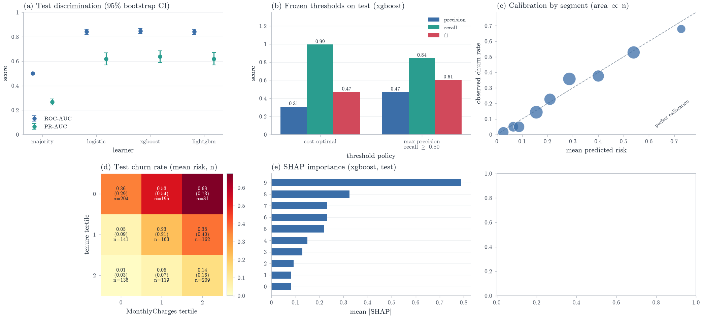

# Customer Segmentation and Retention

A reproducible churn-risk modeling and retention-segmentation study on the
IBM Telco Customer Churn dataset (7,043 customers), with frozen
train/validation/test discipline, calibrated probabilities, declared cost
thresholds, and per-segment retention analysis.

## Overview

This repository rebuilds an earlier churn pipeline that selected models
and thresholds on the test set and dropped rows with blank
`TotalCharges`. The new protocol fixes those defects:

- The Telco CSV is fetched by the Kaggle runner from
  `blastchar/telco-customer-churn`, verified by sha256 against the pinned
  digest `88be4b93...61358a`, and never committed.
- Blank `TotalCharges` values are imputed to 0 (count recorded in the
  data manifest) instead of dropping rows.
- A stratified 60/20/20 train/validation/test split (seed 42) is fixed
  before modeling.
- All preprocessing lives in sklearn Pipelines fit on train only.
- Optuna TPE tunes logistic regression, XGBoost, and LightGBM on train
  with 5-fold stratified CV, ROC-AUC objective, 100 trials, seed 42.
- Sigmoid vs isotonic calibration is chosen per model on validation by
  log loss; the model is selected on validation by PR-AUC.
- Two thresholds freeze on validation before the first test read: a
  cost-optimal threshold under declared costs (FN 780, FP 20) and a
  maximum-precision threshold subject to recall >= 0.80. A sensitivity
  table covers FN/FP ratios {5, 10, 20, 39, 80}.
- The frozen plan (with `card_write_epoch`) is persisted before the test
  partition is touched; `manifest.json` records
  `ordering_ok = card_write_epoch < first_test_read_epoch`.
- Test metrics use 2,000 bootstrap resamples (seed 0): ROC-AUC, PR-AUC,
  log loss, Brier, ECE (15 bins), and precision/recall/F1/expected cost
  at both frozen thresholds.
- Segmentation crosses tenure and MonthlyCharges tertiles (cut points
  from train) and reports, per test segment: n, churn rate, mean
  predicted risk, and flagged counts.
- SHAP global importance on test explains the selected model; it is
  explanatory only.

Retention actions are recommendations under the stated cost assumptions,
not measured savings.

## Data

| Item | Value |
| :--- | :--- |
| Dataset | IBM Telco Customer Churn (`blastchar/telco-customer-churn` on Kaggle) |
| Rows | 7,043 |
| Target | `Churn` (binary) |
| Features | 19 pre-treatment fields; `customerID` excluded |
| Source SHA-256 | `88be4b93fbe0cc83421af1c503794c97c342eca914c1576db7c276e61d61358a` |

## Method

```text
load + sha256 verify -> impute TotalCharges blanks -> stratified 60/20/20
-> per-learner: train-only pipeline + Optuna TPE (100 trials, 5-fold CV,
   ROC-AUC) -> sigmoid/isotonic calibration chosen on validation by log
   loss -> validation PR-AUC selects model -> freeze thresholds on
   validation -> persist plan -> single test read -> metrics, bootstrap
   CIs, segments, SHAP
```

## Results

Kaggle CPU benchmark `churn-benchmark-v1` completed on git SHA
`b3c72b546fb6ad979e46cbc349b9e3c43e3c6dc5` with `ordering_ok=true`
(`card_write_epoch < first_test_read_epoch`). Curated outputs live in
`results/` (unedited kernel copies); `image.png` is rendered from them.



### What the figure shows

- (a) Test discrimination: all three tuned learners reach ROC-AUC about
  0.84-0.85 with overlapping 95% bootstrap CIs, while the majority
  baseline sits at 0.500; xgboost is selected on validation PR-AUC
  (0.6455) and reaches 0.637 PR-AUC [0.589, 0.686] on test.
- (b) Frozen thresholds: the cost-optimal cutoff (0.0243) flags nearly
  every churner (recall 0.995) at precision 0.310; the
  max-precision-at-recall-0.80 cutoff (0.2149) lifts precision to 0.472
  while keeping recall 0.845.
- (c) Calibration by segment: observed churn rate tracks mean predicted
  risk across all nine tenure x charge segments, with marker area
  proportional to segment size.
- (d) Segment grid: test churn rate spans 0.015 (`high__low`, n=135) to
  0.679 (`low__high`, n=81), and each cell annotates mean predicted
  risk and count.
- (e) SHAP importance: Contract dominates mean |SHAP| (0.789), followed
  by tenure (0.324) and MonthlyCharges (0.233); explanatory only.

The frozen xgboost model reaches 0.847 ROC-AUC and 0.637 PR-AUC on the
held-out test set, with predicted risk tracking observed churn in every
segment.

Frozen configuration: 100 Optuna TPE trials per learner, 5-fold stratified
CV on train, ROC-AUC objective, seed 42; sigmoid vs isotonic calibration
by validation log loss; model selection by validation PR-AUC; 2,000
bootstrap resamples (seed 0) for test CIs.

### Model comparison (test, 95% bootstrap CI)

| Model | Val PR-AUC | Calib | ROC-AUC | PR-AUC | Log loss | Brier | ECE |
| :--- | ---: | :--- | ---: | ---: | ---: | ---: | ---: |
| majority | 0.2654 | - | 0.5000 | 0.2654 | 9.567 | 0.265 | 0.265 |
| logistic | 0.6384 | isotonic | 0.8421 [0.821, 0.862] | 0.6183 [0.570, 0.670] | 0.468 | 0.138 | 0.023 |
| xgboost | 0.6455 | isotonic | 0.8465 [0.825, 0.867] | 0.6372 [0.589, 0.686] | 0.414 | 0.135 | 0.025 |
| lightgbm | 0.6378 | isotonic | 0.8411 [0.820, 0.862] | 0.6189 [0.570, 0.671] | 0.423 | 0.138 | 0.022 |

Selected on validation: **xgboost**.

### Frozen thresholds on test (xgboost)

| Threshold | Cutoff | Precision | Recall | F1 | Expected cost/customer |
| :--- | ---: | ---: | ---: | ---: | ---: |
| cost-optimal (FN 780 / FP 20) | 0.0243 | 0.310 | 0.995 | 0.472 | 12.87 |
| max precision s.t. recall >= 0.80 | 0.2149 | 0.472 | 0.845 | 0.605 | 37.13 |

FN/FP sensitivity (validation): ratio 5 -> cutoff 0.164, recall 0.882,
cost 8.91; ratio 39 -> cutoff 0.024, recall 0.992, cost 13.37; ratio 80 ->
cutoff 0.009, recall 1.000, cost 14.02.

### Segments (test, tenure x MonthlyCharges tertiles, cuts from train)

Churn rate ranges from 0.015 (`high__low`: high tenure, low charges, n=135)
to 0.679 (`low__high`: low tenure, high charges, n=81). Mean predicted risk
tracks observed churn rate in every segment (e.g. 0.728 predicted vs 0.679
observed in `low__high`; 0.026 vs 0.015 in `high__low`).

### SHAP global importance (test, xgboost, explanatory only)

Contract 0.789, tenure 0.324, MonthlyCharges 0.233, OnlineSecurity 0.231,
InternetService 0.218.

## Findings

- **XGBoost wins validation but the learners are statistically
  indistinguishable on test.** `metrics.val_pr_auc.xgboost` = 0.6455 vs
  logistic 0.6384 and lightgbm 0.6378; on test the ROC-AUC intervals
  overlap heavily (xgboost [0.8251, 0.8671] vs lightgbm [0.8198, 0.8620] vs
  logistic [0.8206, 0.8624]) and PR-AUC intervals overlap as well. The
  honest claim is that all three learners sit at ROC-AUC ~0.84, well above
  the majority baseline's 0.500.
- **Calibration is good after isotonic recalibration.** Every learner
  chose isotonic over sigmoid on validation log loss (e.g. xgboost
  `val_logloss_by_method.isotonic` 0.4115 < `sigmoid` 0.4230); test ECE is
  0.022-0.025 for all three.
- **Under the declared costs, the cost-optimal policy flags almost
  everyone.** FN costs 39x FP, so the validation-frozen cutoff is 0.0243
  and test recall is 0.995 at precision 0.310; expected cost 12.87 per
  customer vs ~207 for doing nothing (churn rate 0.2654 x 780). This is a
  consequence of the assumed cost ratio, not a measured saving; the
  sensitivity table shows the cutoff rises to 0.164 and expected cost
  falls to 8.91 when FN/FP drops to 5.
- **The recall-constrained threshold is the operationally useful one.**
  At cutoff 0.2149 it reaches precision 0.472 at recall 0.845 (F1 0.605),
  flagging roughly the highest-risk half of customers.
- **Risk is concentrated in low-tenure, high-charge customers.** The
  `low__high` segment (n=81) churns at 0.679 and is fully flagged by both
  thresholds; `high__low` (n=135) churns at 0.015. Segment mean predicted
  risk tracks observed churn rate throughout, so the model's ranking
  transfers to the segmentation use case.
- **Contract type dominates predictions.** SHAP mean |SHAP| ranks Contract
  first (0.789), followed by tenure (0.324) and MonthlyCharges (0.233);
  consistent with the segment pattern (month-to-month contracts churn
  more).

## Provenance

- Protocol: `churn-benchmark-v1`
- Seed: 42 (split, tuning, calibration); bootstrap seed 0
- Declared costs: FN 780, FP 20 (assumptions, not measured)
- Kaggle kernel: `sreeharshak101/customer-segmentation-retention-benchmark`
  (CPU), smoke kernel `...-smoke`
- Source pinned by git SHA in `manifest.json`

## Reproduction

```bash
uv sync
uv run pytest
uv run ruff check .
uv run mypy src
```

Full benchmark (Kaggle CPU):

```bash
scripts/kaggle_run.sh          # versions src + data datasets, pushes, polls
scripts/kaggle_run.sh --smoke  # reduced-trial diagnostic kernel first
```

Local diagnostic run (requires the CSV locally):

```bash
uv run churn benchmark --data Dataset/WA_Fn-UseC_-Telco-Customer-Churn.csv \
    --out benchmark --trials 8 --boot 100 --smoke
```
